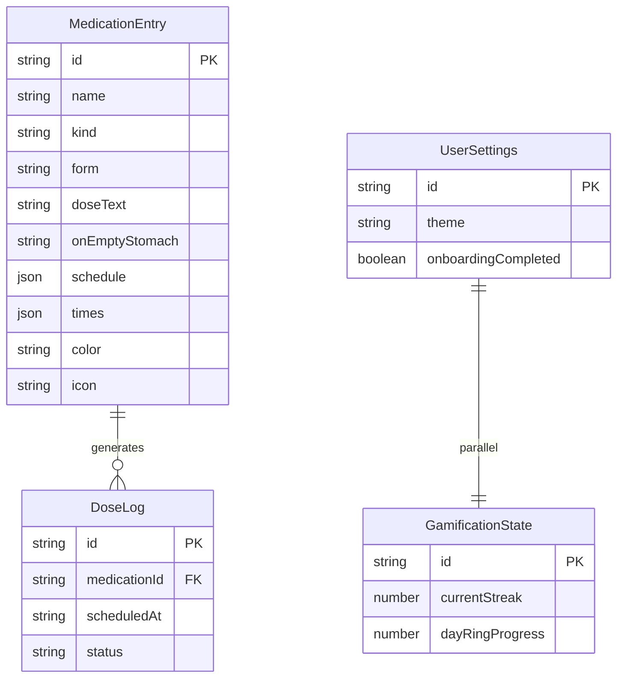

# Model danych MediApp (Dexie v1)

Dane przechowywane **wyłącznie lokalnie** w IndexedDB (`MediAppDB`). Brak konta i synchronizacji w szkielecie.

## Diagram

## MedicationEntry

Pozycja wprowadzona przez użytkownika w kreatorze. Pola takie jak `onEmptyStomach` i `mealTiming` są **notatkami użytkownika** — aplikacja ich nie weryfikuje.

| Pole | Opis |
|------|------|
| `name` | Nazwa wpisana ręcznie |
| `kind` | `prescription`, `otc`, `supplement`, `other` |
| `form` | Forma + opcjonalny `formOtherLabel` |
| `doseText` | Tekst dawki od użytkownika |
| `onEmptyStomach` | `yes` / `no` / `na` |
| `mealTiming` | Opcjonalnie: przed/w trakcie/po posiłku |
| `times` | Lista godzin `HH:mm` |
| `schedule` | Union: daily, weekdays, everyNDays, weekly, monthly, cycle, asNeeded |
| `dateRange` | Opcjonalny okres kuracji |
| `purposeLabel` | Opcjonalna etykieta (filtrowanie), bez walidacji medycznej |
| `color`, `icon` | Personalizacja wizualna |
| `userNote` | Dowolna notatka |

## DoseLog

Wpis dziennika dla widoku „Dziś” i historii.

| Pole | Opis |
|------|------|
| `scheduledAt` | Planowana chwila (ISO) |
| `status` | `planned`, `taken`, `skipped`, `missed` |
| `skipReason` | Opcjonalny powód od użytkownika |
| `takenAt` | Czas odhaczenia |

## UserSettings

Jeden rekord `id: 'default'`: motyw, skala czcionki, onboarding, flagi pod przyszłe snooze/alarm.

## GamificationState

Jeden rekord `id: 'default'`: seria, tarcza, odznaki, postęp pierścienia dnia — w szkielecie bez logiki aktualizacji.
